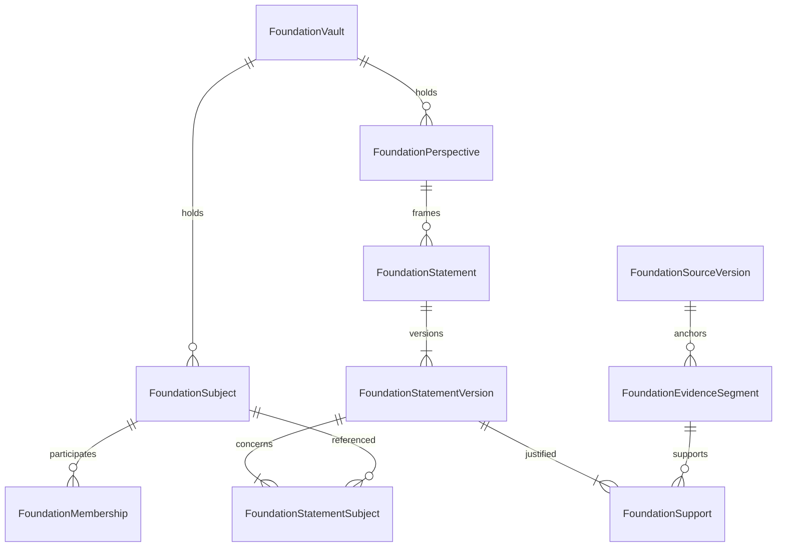

# F-201: physical foundation model

Date: 2026-11-04 (Australia/Melbourne). Review baseline: development `d789464b67dd36524e637e8c35f3610f5ffce278`, which merged PR #13. Status: physical specification implemented by F-202, merged through PR #15 with operator-confirmed DEV deployment, with isolated rehearsal evidence in [F202_INVARIANTS.md](F202_INVARIANTS.md). The models exist in development; no user activation is implied. This completes the physical-design portion of F-201; operator-reported DEV inventory and restoration evidence are recorded in [CURRENT_STATE](../CURRENT_STATE.md).

## Decisions fixed for F-202

- Retain `User` for credentials, sessions and public profile ownership. Keep existing `Person` and its legacy links unchanged. New private subjects do not depend on legacy Person resolution or inherit Contact.personId as verified identity.
- Use a new `FoundationVault` custody root. Do not repurpose `ContextSpace`, remove its guards or make semantic contexts into custody containers. Initially one PRIVATE_HOME vault per owner; no shared vault or multi-custodian write model.
- A typed `FoundationSubject` row is itself the private person, relationship or group reference. There is no generic external `entityId`, mandatory Contact FK or duplicated person/relationship subtype table. PERSON rows carry optional private directory details; RELATIONSHIP/GROUP rows carry descriptive metadata.
- All foundation-owned rows repeat `ownerUserId` and `vaultId` and use compound foreign keys to enforce same-custody references. The authoritative owner comes from the vault and authenticated service context, never caller input.
- Relationships support multiple PERSON members with time-bounded participation. No global unique pair, automatic account notification or assumption of mutual acknowledgement.
- A statement has one perspective and many subjects. Different perspectives create different statements. Self is a PERSON subject representing the owner, not a separate understanding schema.
- F-202 introduces the minimum private evidence/statement schema and semantic associations. Secure account-claim links, recipient grants, public/restricted sync, joint acknowledgement, embeddings and asynchronous discovery are later migrations. Their extension boundaries are specified below; their behaviour must not be simulated with permissive stubs.

## Storage conventions and foreign keys

Use Prisma String/Text IDs generated as UUIDs, consistent with existing User IDs. Use UTC timestamptz(3) for new dates, text ciphertext envelopes, bounded enum values for lifecycle/discriminators, integer positive version numbers and booleans only for real two-state choices. `?` means nullable. IDs and operational timestamps remain database metadata, access-controlled but not claimed to be encrypted.

Every vault-owned entity has `(id, ownerUserId, vaultId)` UNIQUE in addition to its primary key and an FK `(vaultId, ownerUserId)` to `FoundationVault(id, ownerUserId)`. Every domain-to-domain reference includes the full custody tuple; an ID-only FK is insufficient. Every compound FK uses ON UPDATE RESTRICT. Owner, vault, subject kind and version lineage are immutable. Scoped joins carry the same tuple. Explicit exceptions are account-level `User` references and future verified account targets; neither grants traversal rights.

Vault.ownerUserId references User with ON DELETE RESTRICT. Domain references default ON DELETE RESTRICT. No automatic User cascade into foundation content; deletion is an explicit workflow with ordered dependency removal. Join rows can be removed by that workflow before their parents. Do not add PostgreSQL RLS in F-202 and call it security by itself: the current connection is application-wide. Repository enforcement and DB integrity checks have distinct jobs.

## Concrete F-202 tables

Each row below lists fields in addition to common `id`, custody tuple and `createdAt`, unless expressly account-level. `createdAt` defaults to now. All enum values here are finite allowlists, not user-authored labels.

| Table | Fields | Keys and checks |
| --- | --- | --- |
| FoundationEnrollment (account-level) | `userId` PK/FK User RESTRICT; `state` PREPARED/ACTIVE/SUSPENDED; `epoch` int default 1; `createdAt`, `updatedAt` | epoch > 0; one row/account. No row means legacy routing. Enrolment is server-managed, not a browser preference. |
| FoundationVault | `id`; `ownerUserId`; `kind` PRIVATE_HOME; `state` ACTIVE/LOCKED/DELETING; `createdAt`, `updatedAt` | UNIQUE(ownerUserId,kind), UNIQUE(id,ownerUserId); owner immutable. |
| FoundationSubject | `kind` PERSON/RELATIONSHIP/GROUP; `displayNameEnc`; `detailsEnc?`; `selfUserId?`; `state` ACTIVE/ARCHIVED/DELETING; `updatedAt` | UNIQUE(id,ownerUserId,vaultId,kind); UNIQUE(selfUserId); FK selfUserId to User RESTRICT; CHECK selfUserId IS NULL OR (kind=PERSON AND selfUserId=ownerUserId). No email/name uniqueness. |
| FoundationMembership | `containerSubjectId`, `containerKind` RELATIONSHIP/GROUP; `personSubjectId`, `personKind` fixed PERSON; `roleEnc?`; `joinedAt`; `leftAt?` | Both typed subject FKs include kind/custody. CHECK leftAt >= joinedAt when present; partial UNIQUE(vaultId,containerSubjectId,personSubjectId) WHERE leftAt IS NULL. Historical episodes permitted. |
| FoundationPerspective | `kind` OWNER_RECORDED/ATTRIBUTED_PERSON/AI_INTERPRETATION; `holderSubjectId?`, `holderKind?`; `descriptionEnc?` | ATTRIBUTED_PERSON requires holder plus holderKind=PERSON; other kinds require both null. Typed holder FK. Attribution is an owner's record, not authenticated speaker proof. |
| FoundationSource | `kind` OWNER_NOTE/VOICE_NOTE/CONTACT_EXCHANGE/IMPORTED_CONVERSATION; `ingestKey` scoped HMAC; `state` ACTIVE/DISABLED/DELETING; `updatedAt` | UNIQUE(vaultId,ingestKey); content and speaker facts reside in versions. Source kind immutable. |
| FoundationSourceVersion | `sourceId`; `version` int; `previousVersionId?`; `previousVersionNumber?`; `payloadEnc`; `contentMac`; `processingAdmission` STORED_ONLY/PRIVATE_ANALYSIS; `occurredAt?`; `recordedByKind` OWNER/VISITOR/SERVICE; `provenanceEnc` | UNIQUE(sourceId,version); UNIQUE(id,sourceId,version,ownerUserId,vaultId). Version 1 has no predecessor; later version has number=version-1 and predecessor FK to the SAME source, number and custody. Append-only content. |
| FoundationEvidenceSegment | `sourceVersionId`; `speakerSubjectId?`, `speakerKind?`; `anchorEnc`; `excerptEnc`; `anchorMac` | UNIQUE(vaultId,sourceVersionId,anchorMac); typed optional speaker FK with PERSON and paired null check. Encrypted anchor holds turn IDs/UTF-16 offsets/audio milliseconds and encoding. Parent source version FK. |
| FoundationEvidenceSubject | `segmentId`; `subjectId` | UNIQUE(segmentId,subjectId); both scoped FKs. Association is aboutness, never permission. |
| FoundationStatement | `perspectiveId`; `state` ACTIVE/DISABLED/DELETING; `updatedAt` | Scoped immutable perspective FK. Stable identity across versions; state gates all versions. |
| FoundationStatementVersion | `statementId`; `version`; `previousVersionId?`; `previousVersionNumber?`; `textEnc`; `mode` DECLARED/OBSERVED/INFERRED; `confidence` LOW/MEDIUM/HIGH; `observedAt?`; `validFrom?`; `validUntil?`; `provenanceEnc` | UNIQUE(statementId,version); UNIQUE(id,statementId,version,ownerUserId,vaultId); same predecessor rules as source versions. CHECK validUntil >= validFrom when both present. Version content immutable. |
| FoundationStatementSubject | `statementVersionId`; `subjectId` | UNIQUE(statementVersionId,subjectId); scoped FKs. Aboutness belongs to exact version, so changed interpretation need not overwrite old associations. |
| FoundationSupport | `outputVersionId`; `segmentId?`; `inputVersionId?`; `relation` SUPPORTS/QUALIFIES/CONTRADICTS | Exactly one input FK non-null; scoped FKs; CHECK inputVersionId != outputVersionId. Partial unique indexes on output+segment+relation or output+inputVersion+relation. Input must already exist and derivations must remain acyclic. |
| FoundationContext | `labelEnc`; `descriptionEnc?`; `state` ACTIVE/ARCHIVED | No fixed Business/Friendship/Dating enum. Context is private meaning, not a policy grant. |
| FoundationContextAssociation | `contextId`; `segmentId?`; `statementVersionId?` | Exactly one target; scoped FKs; partial UNIQUE(contextId,segmentId) and UNIQUE(contextId,statementVersionId). Contextual aspects of a relationship can be statements about that subject. |

Private directory `detailsEnc` uses a versioned JSON payload with optional email, phone, company, position and preferred-channel values. It contains owner-maintained values only. No live shared profile data is silently copied into it. Relationship/group descriptions use a different versioned JSON shape. Validate payload kind in the service before encryption; SQL cannot inspect ciphertext. Required displayNameEnc may be a neutral private label for unidentified speakers.

For source/statement predecessor FKs, PostgreSQL CHECK must explicitly require both nullable predecessor fields non-null for versions >1; do not rely on SQL NULL truthiness. All paired-null and exactly-one checks must use IS NULL/IS NOT NULL. Optional typed references similarly require both ID and kind together. Kind constants plus composite FKs reject a relationship ID masquerading as a person.

## Diagram: subjects and understanding

Diagram omits custody columns and optional draft/empty states. Membership has two typed links to Subject (container and person); Support may alternatively reference a prior StatementVersion. The table specification controls those details.

## Enforced invariants and transaction boundaries

| Rule | Enforcement in F-202/F-204 |
| --- | --- |
| Same-custody edges | Composite FKs and vault ownership FK in SQL; repositories still authorise each read |
| Person-only member/speaker/perspective holder | Literal discriminator CHECK plus subject compound FK including kind |
| One owner self subject | Unique selfUserId and owner equality CHECK; service creates only from authenticated account |
| Append-only versions, immutable custody/kind/perspective and lineage | SQL update-rejection triggers plus repository API; state changes live on roots, not historic content |
| Subject/support required for a published usable statement version | Deferred constraint triggers at commit: >=1 StatementSubject and >=1 SUPPORTS edge. Block deletion of final association/support while output remains ACTIVE; allow explicit DELETING workflow. All inserted statement versions must be complete at commit. |
| Relationship membership | Service creates relationship with >=2 PERSON members in one transaction; group can start with one. Historical members can leave without deleting relationship. Database checks type/episode uniqueness, not real-world relationship truth. |
| Acyclic statement derivation | Update/lock the vault row for all support-graph and statement-completeness mutation transactions; recursive ancestor check before insert. F-202 SQL trigger enforces the check/lock, including raw writes. Service also rejects cycles with a safe message. |
| Concurrent correction | Lock source/statement root, compare expected latest version, append next version and dependencies atomically. Unique lineage rejects competing version numbers; return conflict for explicit rebase. |
| Replay/idempotency | Scoped ingest key on source, transactional create+version+segment; an identical retry returns original result, changed payload with same key returns conflict |
| Invalid/stale dependencies | Traversal checks root state and current eligible input version. Source/statement correction conservatively makes old dependent outputs ineligible until reassessed; no asynchronous derived store in stage 2. |

Integrity triggers protect persisted shape, not caller identity. A database owner can bypass application controls; do not advertise protection from a compromised privileged connection. F-202 tests must exercise constraints through direct SQL as well as Prisma. Map SQL-only CHECKs, partial indexes, deferred constraints and triggers in comments beside Prisma models and a migration invariant manifest, because Prisma schema alone does not express them all.

Source versions default to STORED_ONLY, preserving current capture/note admission. PRIVATE_ANALYSIS requires recorded owner authorisation in provenanceEnc; recording a note is not automatically permission to derive understanding. Derived outputs require eligible inputs at use time. Changing admission creates a successor version with the authorisation evidence; it does not rewrite old provenance. A version's admission is only a prerequisite and cannot substitute for actor/purpose policy or permit disclosure.

## Identity linkage and continuing sharing extension (stage 4, not F-202)

Private Subject IDs stay stable when someone registers. Do not migrate legacy `Contact.linkedUserId` or `personId` into verified new-domain links. Existing User.personId may remain for legacy compatibility, but it is not a new-domain access path.

A later `FoundationIdentityLink` will carry the usual custody tuple, typed PERSON subject, nullable targetUserId FK, proofSourceVersionId, assurance method, status ACTIVE/REVOKED, createdAt, verifiedAt, revokedAt and reasonEnc. ACTIVE requires target and proof; revoked links cannot authorise lookups. Partial uniqueness allows at most one active account link per private person and one active private person per target account per vault. Link correction revokes the old assertion and inserts a new one; it does not rewrite evidence, merge subjects or move private records. Conflicting existing subjects require explicit review. Account removal first revokes inbound links, clears target identifiers and separately handles proof retention; no cross-owner note deletion is implied.

Stage 4 adds exchange-claim proof, directional grant and restricted projection tables with exact policy-version dependencies. Stage 6 adds version-specific acknowledgement and perspective participation for joint statements; F-202 must not label any perspective JOINT. Cross-vault subject/evidence joins remain prohibited until an explicit authorised projection/reference mechanism exists. These later tables get a physical design before implementation rather than speculative nullable columns now.

## Encryption, indexing and retention

Reuse `src/lib/crypto.ts` AES-GCM and scoped MAC primitives through foundation wrappers. Bind ciphertext AAD to `foundation:v1:<table>:<field>:<owner>:<vault>:<row>`, with row IDs generated before encryption. Copying ciphertext to another row/owner must fail decryption. Use `buildScopedMacToken`, not the normalising equality helper, for exact content/anchor hashes; scope MACs by vault and purpose. Do not alter legacy AAD conventions.

F-202 adds only opaque idempotency/anchor MAC indexes and relational indexes, not global email/phone/name lookup. For the small pilot, decrypt only an authorised bounded page of directory entries for display; a later search implementation must specify its coverage and pagination honestly. Any prefix/full-text/token index is a separate privacy/performance decision before P-301 search ships. Do not persist plaintext snippets, transcript hashes usable for public dictionary matching, embeddings or private context labels as indexes.

Foreign keys need matching query indexes: custody plus subject kind/state; membership container/person; source kind/createdAt; version parent/version; each support input (reverse invalidation); association target; statement state/perspective. Constraints and indexes must use short explicit names under PostgreSQL's identifier limit.

Removing someone from My People archives the subject and hides it by default; it does not delete history or unshare data. Erasure is a separate operation: lock vault/roots, block new processing, compute dependency closure, invalidate/delete affected derived content and links, then delete selected evidence/content. Multi-subject sources require review/redaction into a new source version before erasing the original; never cascade-delete another person's private records. Root/content physical deletion is allowed only by the explicit deletion service after dependents are cleared, with tests for retention exceptions. No indefinite soft-delete substitute for erasure.

Account deletion suspends enrolment and locks the vault first, cancels relevant jobs, revokes future grants/inbound identity targets, then removes foundation-owned content in dependency order before User removal. Legacy account deletion has its own dependent records; do not assume foundation cleanup deletes those safely. No new retention duration is invented here: P-305 must reconcile published policy, backups and operational deletion before external rollout. No external users are enrolled while erasure/restore behaviour is unverified.

## Routing and service contracts for F-203/F-204

No enrolment row: existing legacy path. PREPARED: internal proof only, public routes still legacy; automatic legacy identity claims are suppressed from preparation onward (F-203). ACTIVE: new People/capture/notes path. SUSPENDED: reject new-domain writes and allow only separately authorised recovery reads; never fall back to stale legacy storage. Transition increments epoch under lock; in-flight writes recheck state/epoch in their transaction. Brokerage and existing voice sessions remain legacy by route/workflow, even for an ACTIVE owner. Persist each future foundation job's domain, vault and epoch; existing Network callbacks must not guess from the user's current UI route.

New-account enrolment is created from an explicit server rollout policy or server-validated invitation before any legacy claim side effect. Existing accounts require controlled cutover if private records exist. Resolve public capture destination from published Profile.userId plus persisted enrolment, never visitor-supplied cohort data. Capture into a foundation vault is a narrowly scoped intake operation, not general owner impersonation. Suspended destination returns a recoverable unavailable response.

Proposed private APIs accept a server-created FoundationAccess object (actor, owner, vault, operation, purpose, epoch). Services: `resolveFoundationAccess`, `createPerson`, `createRelationship`, `appendSourceVersion`, `appendStatementVersion`, `readSubject`, `archiveSubject`. Reads return allowlisted projections, not Prisma relation graphs. Error contracts distinguish unavailable/forbidden (without revealing foreign record existence), input validation, idempotency conflict and stale-version conflict. Routes never accept owner/vault from form data as authority.

`src/lib/db.ts` currently scopes only enumerated legacy models. F-204 must register explicit foundation guards and block unscoped foundation model calls, nested relation bypasses, bulk writes and unsafe raw access. Do not add Foundation tables to the old ContextSpace list: they lack contextSpaceId and use different custody. Keep the base client private to repository/transaction adapters; reviewed SQL maintenance has explicit authority. F-202 creates tables only; no route writes until these access guards and F-203 are tested.

## F-202 migration slices and verification

1. Enrolment, vault, subjects, membership and perspectives. No seed/backfill, no changes to legacy trigger behaviour.
2. Sources, versions, segments, evidence-subject links, statements, versions, subjects, support and semantic context associations.
3. SQL-only invariants, immutability/derivation triggers and a checked manifest; generate client and validate schema offline.
4. Rehearse all migrations on an isolated DB populated with representative legacy fixtures. Verify legacy counts/IDs, insert forbidden cross-custody/type/null-lineage cases, concurrency conflicts, derivation cycles, incomplete statements and valid multi-subject writes.
5. Restore the rehearsal snapshot, rerun the migration, record elapsed time and failure behaviour. Do not run migrations against DEV/PROD as part of this design deliverable.

F-202 can begin from this specification using isolated fixtures. Real target inventory, backup evidence and application guard readiness remain hard gates before target migration/cutover or user activation. A rollback after new writes locks the new path and restores compatibility or rolls forward; it does not send users to stale legacy Contacts or drop foundation tables.
